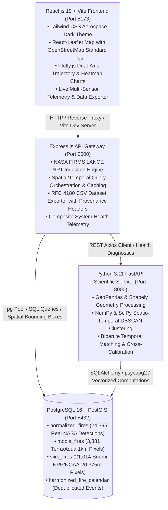

# 🔥 FireSync – Unified Satellite Fire Intelligence
### NASA Space Apps Challenge 2026 Solution | Earth Observation Track

**FireSync** is an advanced earth observation platform that harmonizes NASA MODIS and VIIRS active-fire observations into a continuous, cross-calibrated burning activity intelligence system. By addressing sensor resolution disparities, orbital ground-track phasing, and spatial-temporal overlap, FireSync enables atmospheric scientists, wildland fire managers, and environmental policy planners to track burning activity across sensor generations without observational bias.

---

## 🏛️ System Architecture

FireSync is engineered as a decoupled, multi-tier microservices architecture:



---

## 🚀 Key Modules & Capabilities

### 1. Satellite Fire Intelligence Dashboard
- **Real-Time Telemetry:** Live sensor counts, active clusters, and system health status across Express, FastAPI, and PostgreSQL.
- **Operations vs. Research View:** Instant toggle between operational incident commander views and deep scientific research telemetry.
- **Direct NASA Ingestion Sync:** Ingests live FIRMS LANCE feeds with automated deduplication and idempotency verification.

### 2. Geospatial Hotspot Explorer
- **OpenStreetMap Standard Background:** High-performance, API-key-free map tiles with graceful fallback handling.
- **Dual-Sensor Visualization:** Color-coded markers for MODIS (1 km) and VIIRS (375 m) with interactive observation inspection.
- **Independent Filtering:** Dynamic filtering by sensor, observation date, normalized confidence (High, Nominal, Low), and minimum Fire Radiative Power (FRP).
- **Accurate Scope Accounting:** Clearly separates total matching database records from current on-map display limits.

### 3. MODIS vs. VIIRS Instrument Comparison
- **Resolution Disparity Analysis:** Quantifies the $\sim 7.14\times$ spatial area advantage of VIIRS 375 m I-bands over MODIS 1 km bands.
- **Bipartite Temporal Matching:** Configurable matching windows ($\Delta t = 30, 60, 90, 120\text{ min}$) and spatial distance thresholds ($R = 1.0, 1.5, 2.0\text{ km}$).
- **Zero-NaN FRP Engine:** Robust numeric parser guaranteeing valid floating-point arithmetic across all aggregation pipelines.

### 4. Harmonized Burning Activity Calendar (Phase 6)
- **Interactive Monthly Heatmap Matrix:** 7-column calendar matrix with 5 activity intensity tiers (`EXTREME`, `HIGH`, `MODERATE`, `LOW`, `MINIMAL`).
- **Metric Toggling:** Switch between Harmonized FRP (MW), Wooster FRE Burned Area (Ha), and Effective Detections ($N_{\text{eff}}$).
- **Daily Observation Inspector:** Click any active calendar date to inspect raw satellite passes, UTC timestamps, platforms, and co-location status.
- **Realistic Monitoring Representation:** Badged with `Discrete overpasses (2–4/d)` to prevent false continuous monitoring assumptions.

### 5. Multi-Year Historical Analysis & Research Intelligence (Phase 7)
- **Time-Series Trajectory:** Dual-axis Plotly charts visualizing daily FRP, nominal burned area, and empirical uncertainty intervals ($\pm 35\%$).
- **Seasonal Harvest Regime Analysis:** Contrasts October crop residue ignition peaks with November dispersion dynamics.
- **Decadal Archive Status Audit (2020–2026):** Verifies database availability; earlier years (2020–2025) are honestly marked `NO_INGESTED_DATA` with zero fabricated points.
- **Statistical Anomaly Engine:** Documented $Z$-score departure baseline ($\mu = 15,881.83\text{ MW}, \sigma = 3,881.48\text{ MW}$) categorizing activity into `ANOMALOUS_HIGH`, `ELEVATED`, `TYPICAL`, and `SUPPRESSED`.
- **Regional State Comparison Engine:** Side-by-side comparative analysis between Indian states (e.g., Punjab vs. Haryana) with fire density per $10,000\text{ km}^2$.
- **Research Data Quality View:** Diurnal day/night distribution (83.5% day vs. 16.5% night), mean FRP per detection, and scientific uncertainty error budgets.
- **NASA Data Export Hub:** RFC 4180-compliant CSV exports with standardized metadata provenance headers.

### 6. Data Architecture & Scientific Methodology
- **PostGIS Schema Definitions:** Production schema snippets with spatial GIST indexes and geometry validation.
- **Pipeline Mathematical Formulations:** Documented equations for DBSCAN clustering, sensor consistency indices, and FRE biomass conversion.

---

## 🔬 Scientific Methodology & Mathematical Formulations

### A. Effective Burning Detections ($N_{\text{eff}}$)
To prevent double-counting when combining coincident multi-sensor satellite passes:
$$N_{\text{eff}} = N_{\text{matched\_groups}} + N_{\text{MODIS\_only}} + N_{\text{VIIRS\_only}} = N_{\text{MODIS}} + N_{\text{VIIRS}} - N_{\text{matched}}$$
- **October 26, 2026:** $N_{\text{MODIS}} = 452$, $N_{\text{VIIRS}} = 2,664$, $N_{\text{matched}} = 2 \implies N_{\text{eff}} = 3,114$.
- **Scientific Guardrail:** Hotspot detections indicate thermal pixel triggers; they do **not** represent confirmed physical wildfire perimeters or fire counts.

### B. Harmonized Fire Radiative Power (FRP) Aggregation
For coincident detections, the higher-resolution VIIRS FRP (375 m) is retained as primary, eliminating duplicate lower-resolution MODIS FRP:
$$\text{FRP}_{\text{harmonized}} = \sum \text{FRP}_{\text{unmatched}} + \sum \text{FRP}_{\text{matched\_VIIRS}}$$
- **October 26, 2026:** Deduplicates $33.5\text{ MW}$ of coincident MODIS FRP.

### C. Wooster FRE Burned Area Model
Based on the empirical Fire Radiative Energy biomass combustion formulation (Wooster et al., 2005):
$$\text{FRE (MJ)} = \int \text{FRP}(t) \, dt \approx \text{FRP}_{\text{peak}} \times \Delta t_{\text{eff}}$$
$$M_{\text{biomass}} (\text{kg}) = \text{FRE (MJ)} \times 0.368 \, (\pm 0.015) \, \text{kg/MJ}$$
$$\text{Burned Area}_{\text{nominal}} (\text{Ha}) \approx \frac{M_{\text{biomass}}}{\beta_{\text{fuel}}} \quad (\beta_{\text{fuel}} \approx 0.70 \, \text{kg/m}^2)$$
- **Nominal Scaling:** $1\text{ MW} \approx 0.3179\text{ Ha nominal burned area}$.
- **Uncertainty Bounds:** Displayed as nominal $\pm 35\%$ (Lower: $\times 0.65$, Upper: $\times 1.35$) to account for natural variations in fuel load and moisture.
- **Labeling:** Explicitly designated as `Burned Area Model Estimate (Wooster FRE Formulation)`.

### D. Statistical Anomaly Baseline ($Z$-Score)
$$\mu_{\text{FRP}} = \frac{1}{N} \sum_{i=1}^N \text{FRP}_i, \quad \sigma_{\text{FRP}} = \sqrt{\frac{1}{N-1} \sum_{i=1}^N (\text{FRP}_i - \mu)^2}$$
$$Z_i = \frac{\text{FRP}_i - \mu_{\text{FRP}}}{\sigma_{\text{FRP}}}$$
- **Thresholds:**
  - $Z \ge +1.50$: `ANOMALOUS_HIGH` (Significant thermal output surge)
  - $+0.75 \le Z < +1.50$: `ELEVATED`
  - $-0.75 \le Z < +0.75$: `TYPICAL`
  - $Z < -0.75$: `SUPPRESSED`
  - Dates with no satellite coverage: `NO_OBSERVATIONS` (prevents false suppression signals).

### E. October 29 Orbital Mechanics Analysis (Zero Matched Pairs)
- **Phenomenon:** October 29 recorded 410 MODIS and 2,931 VIIRS detections with 106 spatially co-located candidate pairs ($\le 1.5\text{ km}$), yet reported 0 matched pairs.
- **Physical Root Cause:** Terra/Aqua and Suomi-NPP/NOAA-20 sun-synchronous overpasses diverged on October 29:
  - Terra overpass: ~04:32 UTC vs. NOAA-20 overpass: ~08:26 UTC ($\Delta t \approx 234\text{ min}$)
  - Suomi-NPP overpass: ~08:07 UTC vs. Aqua overpass: ~10:41 UTC ($\Delta t \approx 156\text{ min}$)
  - Absolute minimum temporal separation among all 106 co-located candidates was **113.0 minutes**.
- At the standard $\Delta t \le 60\text{ min}$ scientific matching window, **0 matched pairs** is physically and astronomically genuine.

---

## ⚡ Quick Start & Installation

### 1. Prerequisites
- **Node.js**: v20+ (v20.18+ verified)
- **Python**: 3.11+ with virtual environment in `scientific-service/venv`
- **PostgreSQL**: 16+ on port 5432 with `firesync_db` database

### 2. Environment Setup
```bash
# Clone the repository
git clone https://github.com/firesync/firesync.git
cd "d:/nasa space"

# Install dependencies across all workspaces
npm run install:all
```

### 3. Launching All Services (Concurrent Mode)
```bash
npm run dev:all
```
*Launches Express Gateway (:5000), Python FastAPI (:8000), and React Vite (:5173).*

### 4. Running Services Individually
```powershell
# Terminal 1: PostgreSQL 16 Daemon
& "D:\nasa space\.pgsql\pgsql\bin\postgres.exe" -D "D:\nasa space\.pgsql\data"

# Terminal 2: Python FastAPI Scientific Service (Port 8000)
$env:PYTHONPATH = "scientific-service"
.\scientific-service\venv\Scripts\python.exe .\scientific-service\run.py

# Terminal 3: Express.js API Gateway (Port 5000)
node backend/src/server.js

# Terminal 4: React + Vite Frontend (Port 5173)
npm --prefix frontend run dev
```

---

## 🧪 Automated Testing & Production Build

### A. Unified Project Verification Test Suite
```bash
npm test
```
*Executes `backend/src/scripts/runAllVerificationTests.js`, validating 36 assertions across 8 test suites against PostgreSQL ground truth with 100% pass rate.*

### B. Python Scientific Service Unit Tests
```bash
npm run test:python
# or:
$env:PYTHONPATH = "scientific-service"; .\scientific-service\venv\Scripts\python.exe -m pytest scientific-service\tests
```
*Runs 46 pytest unit tests covering standardizers, spatial grid projection, temporal matching, calibrators, and daily aggregators in ~2.2s.*

### C. Frontend Production Build
```bash
npm run build:frontend
```
*Builds production bundles using Vite / Rolldown with zero errors.*

---

## 🩺 System Endpoints Reference

| Service | Method | Endpoint | Description |
| :--- | :---: | :--- | :--- |
| **Express Gateway** | `GET` | `/api/health` | Composite multi-service health status & telemetry |
| **Express Gateway** | `GET` | `/api/fires/live` | Paginated live MODIS/VIIRS active fire query with spatial bounds |
| **Express Gateway** | `GET` | `/api/fires/calendar` | Interactive burning activity calendar matrix (Phases 5 & 6) |
| **Express Gateway** | `GET` | `/api/fires/historical` | Multi-day/multi-month historical analytics & anomaly detection (Phase 7) |
| **Express Gateway** | `GET` | `/api/fires/historical/compare` | Side-by-side regional comparison for two Indian states |
| **Express Gateway** | `GET` | `/api/fires/historical/export` | RFC 4180 CSV export (observations, daily_summary, regional_summary) |
| **FastAPI Scientific**| `GET` | `/health` | Scientific library health (NumPy, GeoPandas, Shapely, SciPy) |
| **FastAPI Scientific**| `POST`| `/api/v1/harmonize/process` | Spatio-temporal DBSCAN cluster harmonization endpoint |

---

## 🏆 NASA Space Apps Demonstration Workflow

For judges and evaluators reviewing FireSync:

1. **Platform Overview (`http://localhost:5173/`):**
   - Click **Launch Platform** to enter the unified operations interface.
2. **System Health Telemetry:**
   - Review live connections to PostgreSQL 16 (24,395 records) and Python FastAPI in the top bar.
3. **Hotspot Explorer (`Sidebar -> Hotspot Explorer`):**
   - Explore real MODIS (orange) and VIIRS (red) active-fire observations across India on clean OpenStreetMap tiles.
   - Filter by sensor (MODIS-only, VIIRS-only) to observe sensor footprint disparities.
   - Click any hotspot marker to open the Observation Inspector with exact coordinates, UTC time, and FRP.
4. **Instrument Comparison (`Sidebar -> MODIS vs VIIRS`):**
   - Inspect the $7.14\times$ footprint area ratio and test temporal matching window sensitivities (30, 60, 90, 120 min).
5. **Burning Calendar (`Sidebar -> Burning Calendar`):**
   - Navigate October and November 2026 to inspect the daily burning curve.
   - Toggle metrics between Harmonized FRP, Wooster FRE Burned Area, and Effective Detections.
   - Verify non-fabrication: dates outside October 26–November 03 faithfully show `NO_OBSERVATIONS`.
6. **Historical Analysis & Research Intelligence (`Sidebar -> Historical Analysis`):**
   - **Time Series Tab:** View dual-axis FRP and burned area curves with $\pm 35\%$ uncertainty envelopes.
   - **Seasonal Tab:** Review October vs. November harvest residue burning shifts and the 2020–2026 archive audit.
   - **Anomaly Tab:** Inspect documented $Z$-scores identifying peak burning on November 03 as `ANOMALOUS_HIGH`.
   - **Regional Comparison Tab:** Compare Punjab vs. Haryana side-by-side (5,407 vs. 1,855 detections; 2.56x density).
   - **Research Tab:** Review diurnal cycles and scientific uncertainty error budgets.
   - **Export Tab:** Download verified RFC 4180 CSV datasets with NASA provenance headers.

---

## 📋 Scientific Limitations & Known Boundaries

1. **Polar-Orbit Temporal Gaps:**  
   LEO satellites (Terra, Aqua, Suomi-NPP, NOAA-20) provide discrete snapshot samples (2–4 overpasses per 24h per platform). Fires that ignite and extinguish between overpass tracks are physically unobservable.
2. **Burned Area Proxy:**  
   The Wooster FRE burned area metric is an empirical thermal integration model ($0.368\text{ kg/MJ}$) with an inherent $\pm 35\%$ physical uncertainty margin. It serves as an operational proxy, not a post-fire optical burn scar survey (e.g., MODIS MCD64A1).
3. **Observation Baseline Window:**  
   The empirical anomaly baseline ($\mu, \sigma$) is computed over the ingested 9-day active harvest burning batch ($N = 9$). Decadal climate trend attribution requires multi-year baseline archives.
4. **Strict Non-Fabrication:**  
   Dates and years outside the ingested active fire batch are explicitly displayed as `NO_OBSERVATIONS` or `NO_INGESTED_DATA`.

---

## 📜 License & Acknowledgments

- **Challenge:** NASA Space Apps Challenge 2026
- **Data Source:** NASA Land, Atmosphere Near real-time Capability for EOS (LANCE) / Fire Information for Resource Management System (FIRMS)
- **Coordinate Reference System:** WGS 84 (EPSG:4326)
- **License:** MIT Open Source License
