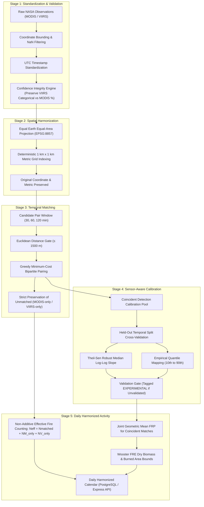

# FireSync Scientific Harmonization Methodology
**NASA Space Apps Challenge 2026**  
*Project: FireSync – Unified Satellite Fire Intelligence*  
*Document Version: 2.0 (Scientific Harmonization Engine)*  
*Target Sensors: NASA EOS MODIS (Terra & Aqua) & SNPP/JPSS VIIRS (Suomi-NPP, NOAA-20, NOAA-21)*

---

## 1. Executive Summary & Objective

The primary objective of the **FireSync Scientific Harmonization Engine** is to synthesize active-fire thermal anomaly observations from the Moderate Resolution Imaging Spectroradiometer (**MODIS**, ~1 km nominal nadir resolution) and the Visible Infrared Imaging Radiometer Suite (**VIIRS**, 375 m I-band nominal resolution) into a continuous, physically consistent, and statistically defensible historical burning activity dataset.

In satellite remote sensing of biomass combustion, directly merging active fire products from different sensor generations without rigorous harmonization introduces severe historical artificial trends. Because VIIRS has approximately $7\times$ higher spatial resolution ($0.14 \text{ km}^2$ vs $1.0 \text{ km}^2$ at nadir) and lower thermal noise equivalents, VIIRS detects significantly more small-scale and cooler agricultural and understory burns than MODIS. A naive sum of detections ($N_{\text{total}} = N_{\text{MODIS}} + N_{\text{VIIRS}}$) creates an artificial inflation in fire frequency coinciding with the launch of Suomi-NPP (2011) and NOAA-20 (2017), obscuring true climate and anthropogenic wildfire trends.

FireSync solves this fundamental Earth science challenge through an end-to-end, multi-stage harmonization pipeline designed in accordance with NASA Earth Science Data and Information System (ESDIS) standards.

---

## 2. Fundamental Scientific Rules & Ethical Constraints

FireSync adheres to five core scientific guardrails:

1. **Non-Additive Fire Counting**: Hotspot detection counts from MODIS and VIIRS must **NEVER** be directly added together ($N_{\text{true}} \ne N_M + N_V$). Coincident detections observe the same fire front and must be treated as a single effective event ($N_{\text{eff}} = N_{\text{matched}} + N_{\text{MODIS\_only}} + N_{\text{VIIRS\_only}}$).
2. **Thermal Anomalies $\ne$ Confirmed Wildfires**: Satellite active-fire observations reflect pixel-integrated radiometric brightness temperature anomalies at overpass time. They indicate thermal emissions (which can include industrial flares, agricultural residue burning, prescribed fires, or active wildfires), not field-delineated wildfire disaster perimeters.
3. **Preservation of Unmatched Observations**: Unmatched observations are **NEVER** discarded or labeled as false positives. Unmatched observations occur naturally due to orbital overpass timing offsets (up to 3 hours between Terra and Suomi-NPP), fire growth or extinguishment, cloud cover movement, and the higher sub-pixel sensitivity of VIIRS.
4. **Prohibition of Universal Multipliers**: A single, universal linear conversion factor between MODIS and VIIRS Fire Radiative Power (FRP) does **NOT** exist. FRP ratios vary significantly based on fuel type, flaming versus smoldering combustion phase, tree canopy obscuration, and atmospheric moisture.
5. **Transparent Validation Labeling**: If empirical calibration cannot be verified against held-out validation partitions with sufficient statistical confidence ($n \ge 10$, $r > 0.4$), the resulting output is strictly labeled as an **`EXPERIMENTAL_UNCALIBRATED_OBSERVED`** activity index.

---

## 3. Stage-by-Stage Mathematical and Architectural Formulation

### Stage 1: Satellite Data Standardization & Validation

Raw active fire feeds from NASA LANCE/FIRMS deliver heterogeneous fields across sensors and products:
- **MODIS (Collection 6.1)**: Acquired by Terra (morning/night: 10:30 / 22:30 Local Solar Time) and Aqua (afternoon/night: 13:30 / 01:30 LST). Reported with numeric detection confidence ranging from $0\%$ to $100\%$.
- **VIIRS (Collection 2)**: Acquired by Suomi-NPP (13:30 / 01:30 LST), NOAA-20 (13:20 / 01:20 LST), and NOAA-21 (13:40 / 01:40 LST). Reported with strictly **categorical** confidence: `'l'` (low), `'n'` (nominal), `'h'` (high).

#### Mathematical Normalization
1. **Coordinate Verification**:
   $$\text{Valid}(\phi, \lambda) \iff (-90.0^\circ \le \phi \le 90.0^\circ) \land (-180.0^\circ \le \lambda \le 180.0^\circ) \land \phi \notin \text{NaN} \land \lambda \notin \text{NaN}$$
2. **UTC Timestamp Standardization**:
   Temporal components ($\text{acq\_date}$ and $\text{acq\_time}$) are converted to UTC ISO-8601 timestamps:
   $$t_{\text{UTC}} = \text{Datetime}(\text{Year}, \text{Month}, \text{Day}, \text{Hour}, \text{Minute}, \text{tz}=\text{UTC})$$
3. **NASA Confidence Integrity Guarantee**:
   To prevent corruption of scientific data:
   - For **MODIS**: Preserve raw string, standardize to category (`LOW` $< 30\%$, `NOMINAL` $30\text{--}80\%$, `HIGH` $> 80\%$), preserve exact NASA numeric percentage, and assign internal score.
   - For **VIIRS**: `confidence_percent` is strictly enforced as **`NULL / None`**. Never invent a fake numeric percentage for VIIRS! Categorical classes (`low`, `nominal`, `high`) map to standardized category strings, while an internal algorithmic rating is saved under the clearly distinct attribute `estimated_internal_score`.
4. **Physical Limits Clamping**:
   $$\text{FRP}_{\text{valid}} = \max(0.0 \text{ MW}, \text{FRP}_{\text{raw}})$$
   $$T_{B, \text{valid}} = \max(150.0 \text{ K}, \min(600.0 \text{ K}, T_{B, \text{raw}}))$$

---

### Stage 2: Spatial Harmonization (Equal-Area Metric Grid)

#### The Angular Distortion Fallacy
Assigning observations directly to geographic degree bins (e.g. $0.01^\circ \times 0.01^\circ$) introduces severe latitudinal distortion. On an ellipsoid:
$$\Delta x = R_{\text{Earth}} \cdot \cos(\phi) \cdot \Delta \lambda$$
$$\Delta y = R_{\text{Earth}} \cdot \Delta \phi$$
At the equator ($\phi = 0^\circ$), $1^\circ \approx 111.32 \text{ km}$. However, at $30^\circ\text{N}$ (e.g. Punjab, India), $\cos(30^\circ) = 0.866$, meaning an angular bin covers $13.4\%$ less physical area than at the equator. At $60^\circ\text{N}$, the area shrinks by $50\%$.

#### Equal Earth Equal-Area Projection (`EPSG:8857`)
To ensure that every nominal $1 \text{ km} \times 1 \text{ km}$ grid cell covers exactly $1.0 \text{ km}^2$ ($100 \text{ hectares}$) anywhere on Earth, FireSync projects all coordinates via the **Equal Earth** projection (`EPSG:8857`):
$$(\phi, \lambda) \xrightarrow{\mathcal{T}_{\text{forward}}} (x_m, y_m)$$
Grid coordinates $(col_i, row_j)$ and unique deterministic cell identifiers are computed via:
$$col_i = \left\lfloor \frac{x_m}{\Delta_{\text{res}}} \right\rfloor, \quad row_j = \left\lfloor \frac{y_m}{\Delta_{\text{res}}} \right\rfloor$$
$$\text{Cell\_ID} = \text{G1KM\_}\{col_i:+08d\}\_\{row_j:+08d\}$$
Cell centroids $(x_c, y_c)$ in projected meters and $(\phi_c, \lambda_c)$ in geographic coordinates are calculated by inverting the center:
$$x_c = col_i \cdot \Delta_{\text{res}} + \frac{\Delta_{\text{res}}}{2}, \quad y_c = row_j \cdot \Delta_{\text{res}} + \frac{\Delta_{\text{res}}}{2}$$
$$(\phi_c, \lambda_c) = \mathcal{T}_{\text{inverse}}(x_c, y_c)$$

#### Documented Spatial Limitations
- **Centroid-Based Assignment**: Satellite active-fire detections represent integrated footprints over surface areas (nominal $1 \text{ km}$ for MODIS at nadir expanding to $\sim 4.8 \times 2.0 \text{ km}$ at scan edge; and $375 \text{ m}$ for VIIRS). A fire detection near a cell boundary extends into adjacent cells. Centroid indexing is a spatial discrete reference tool and does not imply combustion was confined solely within that single cell.
- **Intra-Cell Fire Independence**: Detections within the same grid cell must **NOT** be assumed to represent the same individual fire. A single $1 \text{ km}^2$ cell can contain multiple separate agricultural burn piles, separate wildland ignitions, or independent advancing fire fronts.

---

### Stage 3: Spatio-Temporal Observation Matching

#### Matching Gates and Formulation
For any pair of observations $M$ (MODIS) and $V$ (VIIRS):
1. **Temporal Gate**:
   $$\Delta t = |t_M - t_V| \le \Delta t_{\max} \quad (\text{configurable: } 30, 60, \text{ or } 120 \text{ minutes})$$
2. **Spatial Metric Gate**:
   $$d(M, V) = \sqrt{(x_M - x_V)^2 + (y_M - y_V)^2} \le d_{\max} \quad (\text{default: } 1500 \text{ meters})$$
3. **Normalized Cost Function**:
   $$C(M, V) = (1 - w_t) \cdot \frac{d(M, V)}{d_{\max}} + w_t \cdot \frac{\Delta t}{\Delta t_{\max}}$$
   where $w_t = 0.5$ balances spatial and temporal proximity.

#### Bipartite Mutual Nearest-Neighbor Optimization
To prevent one MODIS detection from pairing with multiple neighboring VIIRS detections (or vice versa):
1. All candidate pairs passing both gates are sorted in ascending order of cost $C(M, V)$.
2. Pairs are assigned greedily: once observation $M_i$ is matched to $V_j$, neither $M_i$ nor $V_j$ may be paired with any other detection.
3. Remaining detections are partitioned into `MODIS-only` and `VIIRS-only` sets.

---

### Stage 4: Sensor-Aware Calibration

Because MODIS and VIIRS detect the same physical fire with different point spread functions and channel bandwidths, FireSync performs cross-sensor calibration on the coincident matched pairs pool.

#### Statistical Distribution Metrics
For any FRP series $X = \{x_1, x_2, \dots, x_n\}$:
- Mean: $\mu = \frac{1}{n} \sum x_i$
- Median: $Q_2 = \text{median}(X)$
- Standard Deviation: $\sigma = \sqrt{\frac{1}{n-1} \sum (x_i - \mu)^2}$
- Skewness: $\gamma_1 = \frac{\frac{1}{n} \sum (x_i - \mu)^3}{\left(\frac{1}{n} \sum (x_i - \mu)^2\right)^{3/2}}$
- Percentiles: $P_{10}, P_{25}, P_{50}, P_{75}, P_{90}$

#### Robust Theil-Sen Median-Slope Regression
FRP distributions exhibit heavy positive skewness (power-law behavior) with occasional extreme wildfire values. Ordinary Least Squares (OLS) is severely biased by outliers. FireSync applies the **Theil-Sen median estimator** on log-transformed variables:
$$\log_{10}(\text{FRP}_{\text{VIIRS}}) = \beta \cdot \log_{10}(\text{FRP}_{\text{MODIS}}) + \alpha$$
The slope $\beta$ is computed as the median of slopes between all distinct pairs of points:
$$\beta = \text{median} \left\{ \frac{\log_{10}(V_j) - \log_{10}(V_i)}{\log_{10}(M_j) - \log_{10}(M_i)} : M_i \ne M_j \right\}$$
$$\alpha = \text{median} \left( \log_{10}(V_i) - \beta \cdot \log_{10}(M_i) \right)$$

#### Empirical Quantile Mapping (EQM)
To correct non-linear distribution shifts across the dynamic range, cumulative distribution percentiles ($10\%, 25\%, 50\%, 75\%, 90\%$) are matched between MODIS and VIIRS:
$$\text{FRP}_{\text{VIIRS}} = F_{\text{VIIRS}}^{-1} \left( F_{\text{MODIS}}(\text{FRP}_{\text{MODIS}}) \right)$$

#### Held-Out Temporal Partition Cross-Validation
Validation is performed on held-out temporal partitions (e.g. later observation dates). Metrics reported:
$$\text{MAE} = \frac{1}{k} \sum_{i=1}^k |\hat{V}_i - V_i|, \quad \text{RMSE} = \sqrt{\frac{1}{k} \sum_{i=1}^k (\hat{V}_i - V_i)^2}, \quad r = \frac{\sum (\hat{V} - \bar{\hat{V}})(V - \bar{V})}{\sigma_{\hat{V}} \sigma_V}$$
If $k < 5$ or $r < 0.4$, the calibration status is tagged as `EXPERIMENTAL_UNCALIBRATED`.

---

### Stage 5: Daily Harmonized Activity Synthesis

#### Effective Independent Fire Counting
$$N_{\text{eff}} = N_{\text{matched}} + N_{\text{MODIS\_only}} + N_{\text{VIIRS\_only}}$$
Notice that $N_{\text{eff}} \le N_{\text{MODIS}} + N_{\text{VIIRS}}$, strictly preventing double-counting coincident detections while honoring independent burns.

#### Harmonized Fire Radiative Power
For coincident pairs, the joint estimate employs the geometric mean to minimize sensitivity to single-sensor instrument saturation or bow-tie distortion:
$$\text{FRP}_{\text{joint}} = \sqrt{\text{FRP}_{\text{MODIS}} \cdot \text{FRP}_{\text{VIIRS}}}$$
Daily total harmonized FRP across all events in a region:
$$\text{FRP}_{\text{total}} = \sum_{g \in \text{matched}} \text{FRP}_{\text{joint}, g} + \sum_{m \in \text{MODIS\_only}} \text{FRP}_m + \sum_{v \in \text{VIIRS\_only}} \text{FRP}_v$$

#### Wooster FRE Burned Area Estimation
Following the empirical physics established by Wooster et al. (2005):
$$\text{FRE} (\text{MJ}) = \text{FRP} (\text{MW}) \times (t_{\text{duration}} \times 3600 \text{ s})$$
$$\text{Biomass Consumed} (\text{kg}) = \text{FRE} \times C_e \quad \left(C_e = 0.368 \pm 0.015 \text{ kg/MJ}\right)$$
$$\text{Estimated Burned Area} (\text{ha}) = \frac{\text{Biomass Consumed (metric tons)}}{\text{Fuel Consumption Density (tons/ha)}}$$
- **Nominal estimate**: $25.0 \text{ tons/ha}$ (mixed agricultural / open woodland)
- **Lower bound**: $45.0 \text{ tons/ha}$ (dense canopy forest)
- **Upper bound**: $15.0 \text{ tons/ha}$ (sparse scrub and grassland)

---

## 4. Architectural Implementation & Endpoints

### FastAPI Endpoints (`scientific-service`)
- `POST /api/v1/harmonize/pipeline`: Complete 5-stage orchestration pipeline.
- `POST /api/v1/harmonize/from-db`: Direct ingestion from PostgreSQL `normalized_fires` table into `harmonized_fire_calendar`.
- `POST /api/v1/harmonize/standardize`: Standalone Stage 1 validation.
- `POST /api/v1/harmonize/spatial-grid`: Standalone Stage 2 Equal Earth grid assignment.
- `POST /api/v1/harmonize/temporal-match`: Standalone Stage 3 bipartite spatio-temporal matching.
- `POST /api/v1/harmonize/calibrate`: Standalone Stage 4 Theil-Sen and Quantile cross-calibration.
- `POST /api/v1/harmonize/daily-activity`: Standalone Stage 5 daily calendar synthesis.
- `GET /api/v1/harmonize/status`: Engine parameter specs, CRS constants, and scientific guardrails.

### Express API Gateway Routes (`backend`)
- `GET /api/fire/status`: Proxies pipeline configuration and service health.
- `POST /api/fire/pipeline`: Proxies full 5-stage harmonization pipeline.
- `POST /api/fire/from-db`: Executes database-driven harmonization and updates calendar.
- `POST /api/fire/harmonize`: Backward-compatible legacy cluster harmonization route.
- `POST /api/fire/ingest`: Triggers on-demand NASA FIRMS CSV ingestion.
- `GET /api/fire/live`: Queries normalized raw satellite observations from PostgreSQL.

---

## 5. Summary of Verification & Test Suite

The harmonization engine is verified by a 37-test automated suite (`pytest`):
- `test_stage1_standardizer.py`: 11 tests covering coordinate bounding, UTC timestamp parsing, MODIS percentage preservation, and VIIRS categorical `NULL` percent enforcement.
- `test_stage2_spatial_grid.py`: 4 tests validating Equal Earth projection, forward/inverse metric consistency, 1000m discrete indexing, and scientific documentation strings.
- `test_stage3_temporal_matcher.py`: 3 tests confirming 30/60/120 min windows, bipartite double-matching prevention, and unmatched preservation.
- `test_stage4_calibrator.py`: 6 tests evaluating distribution metrics, sparse sample `EXPERIMENTAL` tagging, Theil-Sen regression, quantile mapping, and coincident activity estimation.
- `test_stage5_daily_aggregator.py`: 3 tests evaluating Wooster FRE biomass/burned area bounds, non-additive effective detection counts, and data availability flags.
- `test_pipeline_e2e.py`: 10 tests confirming end-to-end multi-stage pipeline flow and FastAPI endpoint response models.

